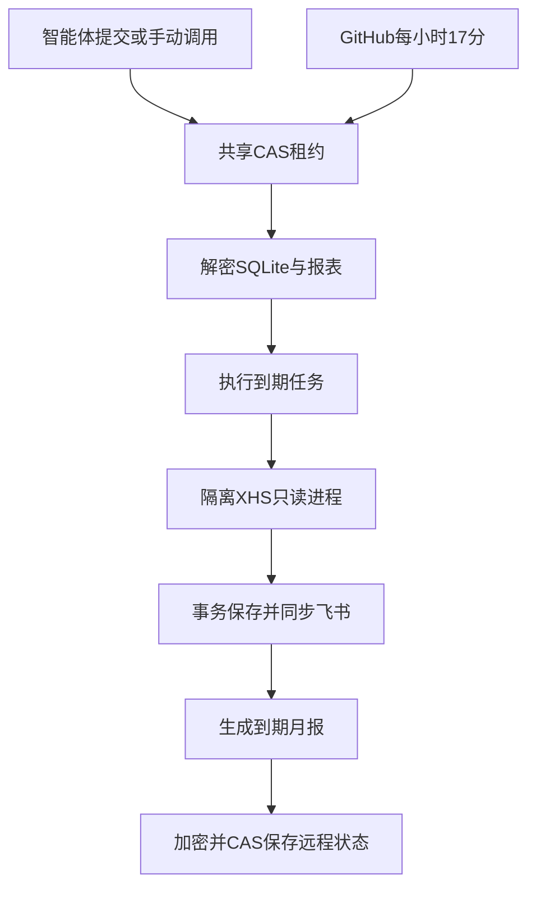

# 免费无人值守：部署与边界

## 当前验证

仓库已确认公开，标准ubuntu-latest运行器的公共仓库任务免费，不用付费大规格运行器。
已通过GitHub API建立koc-state分支、加密保存真实台账；当前云端使用共享状态完成恢复、真实刷新、飞书同步和再次保存。
Actions设置及密钥公钥接口返回403，当前连接不能配置Actions Secrets/启用变量；尚未在GitHub运行器验证真实采集。

## 数据流

独立随机32字节密钥，AES-256-GCM，不复用飞书凭证。代码分支无数据库、报表或密钥；业务状态在koc-state仅为密文。租约只含随机owner与到期时间。
CAS竞争或租约丢失停止覆盖，提交失败留加密recovery文件。空闲时不反复提交大密文，仍会有小型租约提交。
旧密文保留在Git历史，需要定期检查仓库体积，密钥独立备份。加密键不可随意重新生成覆盖。

## GitHub启用设置

仓库Settings → Secrets and variables → Actions：

| 类型 | 名称 | 内容 |
|---|---|---|
| Secret | FEISHU_APP_SECRET | 同一个飞书应用的真实App Secret |
| Secret | KOC_STATE_KEY | 当前私有密钥文件中的单行内容 |
| Variable | KOC_AUTOMATION_ENABLED | 完成手动运行验证后才设true |

云环境Secret不自动复制到GitHub，不要上传代理占位符或在聊天发送密钥。
App ID/台账标识已在加密库，恢复后读取；GitHub自带github.token处理同仓库状态，无需新建PAT。
代码合入默认分支后手动运行KOC scheduled collection，验证源站、同步和状态。手动触发不受定时开关限制；schedule受启用变量控制。缺少凭证会在采集前失败。
代码已含schedule，但尚未合入并启用。每小时17分避开整点；GitHub可能延迟/丢弃，按真实时间处理晚采。
job上限55分钟，采集循环45分钟，每轮最多200项，未完下轮继续。500条不是同一时刻完成。

## 云端与回退

忽略的.env保存非秘密路由：KOC_REMOTE_STATE、KOC_GITHUB_REPO、KOC_STATE_KEY_FILE、KOC_UPSTREAM_ROOT。密钥在/workspace/private，不提交Git。
安装用uv sync --frozen和bash scripts/install_xhs.sh；运行用uv run --frozen koc run-once。
安装器支持KOC_UPSTREAM_ROOT，GitHub运行器不需要/workspace或管理员权限。
恢复时若远程状态缺失会报错，不创建空库冒充成功。关闭启用变量可停止后续job。
私有仓库会被费用前置检查拒绝，避免未经验证的配额/超额费用。
若运行器不能正常访问小红书，保留错误及当前云端手动触发路线，不声称无人值守已上线。
