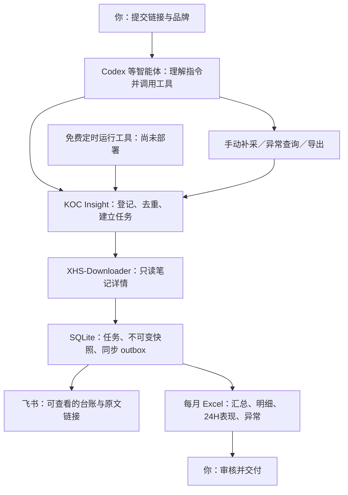

# 操作与职责

| 组件 | 职责 | 当前状态 |
|---|---|---|
| 用户 | 指定品牌、提供授权链接、审核 Excel | 流程已确认 |
| Codex/其他客户端 | 把自然语言转成工具调用 | 标准 MCP 本地通信已测；真实客户端配置待接入 |
| KOC Insight | 登记、排程、快照、异常、报表、同步 | Mock 核心已实现 |
| XHS-Downloader | 获取可访问的公开详情 | 本机 API 合约已测；真实采集受网络/安全配置阻塞 |
| 飞书 | 查看结果，保留链接 | 适配器 Mock 已测，真实应用/表权限待配置 |
| 免费定时工具 | 无人值守唤醒任务 | 可行性研究，未激活、未上线 |

关闭智能体不应取消后台任务，但目前尚无已部署的后台机器，不能依赖此图认为自动运行已生效。
